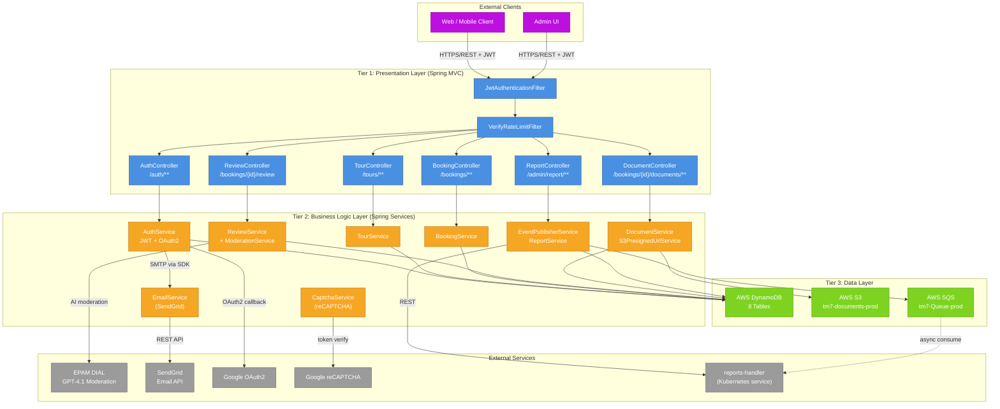

<!-- ARCHITECTURE_TYPE: 3-TIER -->

# Section 3 — Architecture Layers

[Architecture](../ARCHITECTURE.md)

---

## Overview

The `api-handler` follows a **classic 3-Tier Architecture**:

| Tier | Name | Role |
|------|------|------|
| **Tier 1** | Presentation Layer | REST controllers, security filters, request/response marshalling |
| **Tier 2** | Application / Business Logic Layer | Services, business rules, orchestration, external API clients |
| **Tier 3** | Data Layer | DynamoDB repositories, S3 presigned URL service, SQS event publisher |

This is a single deployable service — all three tiers run inside the same Spring Boot JVM. The tier boundaries are enforced by package structure and dependency direction (controllers → services → repositories), not by network boundaries.

---

## Tier 1: Presentation Layer

**Purpose**: Receive HTTP requests, authenticate/authorise callers, delegate to the appropriate service, and format responses.

**Components**:
- REST Controllers: `AuthController`, `TourController`, `BookingController`, `ReviewController`, `DocumentController`, `ReportController`
- Security Filters: `JwtAuthenticationFilter`, `VerifyRateLimitFilter`
- Argument Resolvers: `CurrentUserArgumentResolver`
- Exception Handlers: `GlobalExceptionHandler`, `AuthExceptionHandler`, `ReviewControllerAdvice`, `TourControllerAdvice`

**Technologies**:
- Spring Boot 3.0.3 (Spring MVC, embedded Tomcat)
- Spring Security 6 (`SecurityFilterChain`)
- SpringDoc / OpenAPI 3 (`springdoc-openapi-starter-webmvc-ui 2.3.0`)
- Lombok (boilerplate reduction)

**Key Responsibilities**:
- Parse and validate incoming JSON request bodies (`@Valid`, Jakarta Validation)
- Authenticate via JWT (`JwtAuthenticationFilter`) or OAuth2 session
- Rate-limit OTP/verification endpoints (`VerifyRateLimitFilter`)
- Route requests to the correct service method
- Map service exceptions to structured HTTP error responses
- Serve OpenAPI documentation at `/swagger-ui.html`

**Communication Patterns**:
- Inbound: HTTPS/REST from frontend clients; JSON payloads; Bearer JWT in `Authorization` header
- Outbound: Method calls to Tier 2 services
- CORS: Configured origin allowlist via `${ALLOWED_ORIGINS}` environment variable

**Non-Functional Requirements**:
- Response time p95 < 500ms (see [Key Metrics](01-system-overview.md#16-key-metrics))
- Stateless — no HTTP session state per [P1](02-architecture-principles.md#p1--stateless-application-layer)

---

## Tier 2: Application / Business Logic Layer

**Purpose**: Execute all business logic, enforce rules, orchestrate multi-step workflows, and integrate with external systems.

**Components**:
- Auth: `AuthService`, `JwtService`, `VerificationTokenService`, `CustomUserDetailsService`, `OAuth2UserService`
- Tour: `TourService`
- Booking: `BookingService`
- Review: `ReviewService`, `ModerationService`
- Document: `DocumentService`, `S3PresignedUrlService`
- Reporting: `EventPublisherService`, `ReportService`
- Notifications: `EmailService` (SendGrid)
- Captcha: `CaptchaService`
- External client: `Service2Client` (REST client for `reports-handler`)

**Technologies**:
- Spring Boot 3 services / `@Service` components
- JJWT 0.12.5 (JWT generation and validation)
- Spring Security OAuth2 Client (Google login)
- Azure OpenAI SDK 1.0.0-beta.16 (DIAL moderation)
- Spring WebFlux `WebClient` (async REST calls)
- Spring `RestTemplate` (sync REST calls to `reports-handler`)
- Spring Cloud AWS SQS (`io.awspring.cloud:spring-cloud-aws-starter-sqs`)

**Key Responsibilities**:
- User registration, verification, authentication, password reset
- Tour availability and filtering
- Booking lifecycle management (create, update, cancel, status transitions)
- Review CRUD with AI moderation gate
- S3 presigned URL generation for document upload
- SQS event publishing for booking status changes and reviews
- Aggregate report generation and CSV/PDF export
- Email notifications via SendGrid
- Google reCAPTCHA token validation

**Communication Patterns**:
- Inbound: Method calls from Tier 1 controllers
- Outbound: DynamoDB via repositories (Tier 3), S3 SDK calls, SQS SDK calls, HTTP to SendGrid, HTTP to DIAL, HTTP to reCAPTCHA, HTTP to `reports-handler`
- Pattern: Synchronous for user-facing operations; asynchronous SQS publish for reporting side-effects per [P4](02-architecture-principles.md#p4--asynchronous-event-publishing-for-side-effects)

**Non-Functional Requirements**:
- Stateless — all state externalised per [P1](02-architecture-principles.md#p1--stateless-application-layer)
- Moderation timeout: 5000ms max (configurable via `dial.moderation.timeout-ms`)
- Moderation retries: 2 attempts (configurable via `dial.moderation.max-attempts`)

---

## Tier 3: Data Layer

**Purpose**: Persist and retrieve all domain data; provide file storage and event messaging.

**Components**:
- Repositories: `UserRepositoryImpl`, `TourRepositoryImpl`, `BookingRepositoryImpl`, `ReviewRepositoryImpl`, `DocumentRepositoryImpl`, `TravelAgentRepositoryImpl`, `JwtBlacklistRepository`, `VerificationTokenRepository`
- AWS DynamoDB (8 tables): `Users`, `Tours`, `Bookings`, `Reviews`, `Documents`, `TravelAgents`, `JwtBlacklist`, `Tokens`
- AWS S3 bucket: `tm7-documents-prod`
- AWS SQS queue: `tm7-Queue-prod`

**Technologies**:
- Spring Cloud AWS DynamoDB enhanced client (`io.awspring.cloud:spring-cloud-aws-starter-dynamodb`)
- AWS SDK v2 (`software.amazon.awssdk:s3`, `software.amazon.awssdk:sts`)
- AWS SQS via Spring Cloud AWS SQS starter

**Key Responsibilities**:
- CRUD operations on all domain entities via DynamoDB
- JWT blacklist persistence (logout invalidation)
- Verification token lifecycle (OTP storage and expiry)
- S3 presigned URL generation for direct browser-to-S3 upload
- SQS message publication for downstream event consumers

**Communication Patterns**:
- Inbound: Method calls from Tier 2 services
- Outbound: AWS DynamoDB API (HTTPS), AWS S3 API (HTTPS), AWS SQS API (HTTPS)
- Region: `ap-southeast-2` (all AWS services)

**Non-Functional Requirements**:
- DynamoDB tables pre-provisioned externally (IaC); no DDL in application code
- STS role assumption for AWS credential rotation: role `org/DeveloperAccessRoleTeam7` on account `317356818777`
- S3 presigned URLs valid for [To be defined — set in S3PresignedUrlService]

---

## Architecture Diagram

---

## Tier Boundary Rules

1. **Tier 1 → Tier 2 only**: Controllers call services only. Controllers never call repositories directly.
2. **Tier 2 → Tier 3 only**: Services call repositories or AWS SDK clients. Services never call controllers.
3. **No cross-tier skipping**: No Tier 1 → Tier 3 calls. Enforced by package-private repository constructors and Spring DI.
4. **Stateless Tier 2**: Services are Spring singletons with no request-scoped state stored in instance variables. Per [P1](02-architecture-principles.md#p1--stateless-application-layer).

